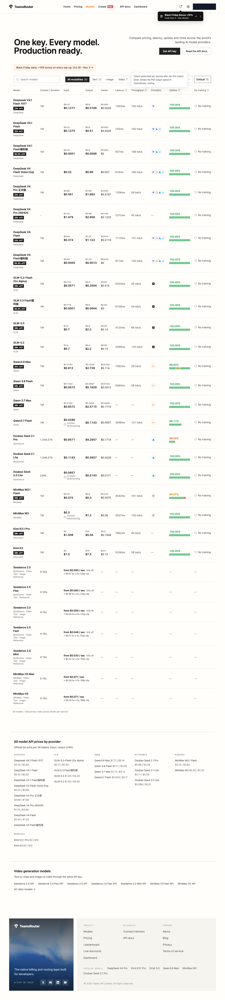
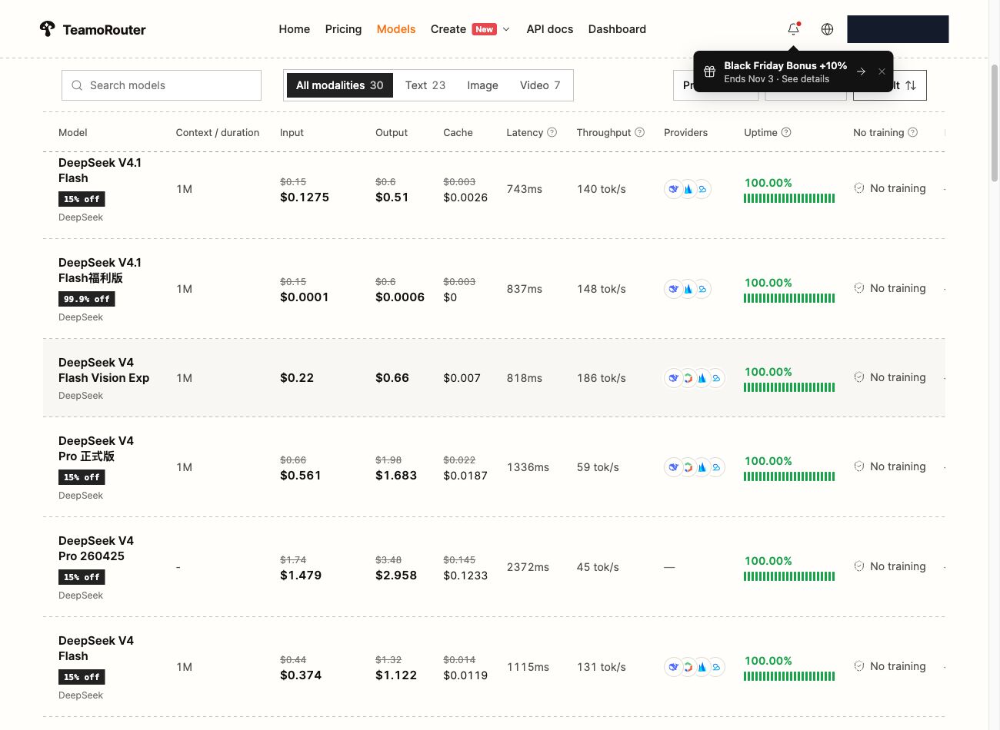

# TeamoRouter Review: 30 Models, USD Pricing, and Per-Second Video Billing

TeamoRouter puts text and video models behind one OpenAI- and Anthropic-compatible gateway. The catalog currently lists **30 models: 23 text, 7 video**, and everything is priced in USD — text in USD per million tokens with separate input, output, and cache columns; video per second with a five-second sample estimate.

[Open the TeamoRouter catalog and pricing page](https://teamorouter.com/share?i=e6d77aac74)

> **Decision:** Pick it when you need text and video on one key and think in USD budgets. Skip it when you only want the cheapest text model, or when you must pay in CNY.
>
> **For:** teams generating short video and also running copy or code through one account  ·  **Not for:** text-only buyers, or anyone who needs Alipay settlement

## Two billing units that must never be compared directly

Text is billed per **1M tokens**. Video is billed per **second**. These are not interchangeable numbers, and the catalog deliberately shows them side by side.

| Type | Example model | Unit | Context / duration |
|---|---|---|---|
| Text | DeepSeek V4.1 Flash | $0.3 in / $1.2 out per 1M | 1M |
| Text | GLM-5.3 | $1.4 in / $4.4 out per 1M | 1M |
| Text | Kimi K3.1 Pro | $2 in / $10 out per 1M | 1M |
| Video | Seedance 2.5 | from $0.090 / sec | 4–30s |
| Video | Seedance 2.0 Mini | from $0.030 / sec | 4–15s |

## The two-line price cell is not two charges

Cells often stack an original price above a discounted one, with a note like `15% off`. The lower number is what you actually pay. Adding the two lines together doubles your estimate.

A separate class of models is marked `99.9% off` with prices down to roughly $0.0001 per million tokens. Those are discount tiers; check the catalog on the day you buy instead of budgeting them as the standing rate.

Models marked `Context-tiered pricing` change rate with context length. Long-document work needs its own estimate, not the single number in the list.

## Budget video by the clip, then by the month

For Seedance, multiply the per-second price by the clip length, then by how many clips you ship. Sixty 5-second 720p clips per month costs roughly $19 on Mini versus roughly $58 on 2.5. The gap is tier, not discount — decide whether 2.5 quality is required before topping up.

[Check your model and tier against the live price list](https://teamorouter.com/share?i=e6d77aac74)

## Access and top-up

Public top-up tiers are $10 / $20 / $50 / $200 with a $5 custom minimum, settled through Stripe checkout in USD. The site states there is no subscription and credits do not expire.

Base URL: `https://api.teamorouter.cn/v1`, with both OpenAI and Anthropic compatible protocols. Existing SDKs and clients work by filling in the address and key.

## When it is the wrong tool

If you only run text, the video capability has no value to you while still being part of how the catalog is priced — a text-only gateway will be cheaper. If you need CNY or Alipay settlement, confirm that separately before committing.

[Start with a minimal call before batching](https://teamorouter.com/share?i=e6d77aac74)

## Related guides

Other relay reviews on this account, split by scenario:

- [Hakimi API review](https://github.com/Ernesto90998/hakimi-api-review-en) — per-request image pricing, a useful complement to per-second video
- [VS Cloud review](https://github.com/Ernesto90998/vsllm-review-en) — per-request text billing for high-frequency short prompts
- [HC gateway review](https://github.com/Ernesto90998/hc-api-review-en) — free tier plus subscription, for the tightest starting budget

## FAQ

### Do text and video share one balance?

Yes, one account balance. Still create separate keys with their own quotas so a video run cannot drain the text budget.

### Is the five-second sample the real price?

No. It is one specific combination of 5 seconds and 720p. Changing resolution or duration changes the total.

### Can I lock in a discount?

No. Discounts are campaign pricing and requests bill at the rate in effect at request time. Budget at list price.

---

If this saved you a comparison pass, star the repo — pricing updates land here first.
